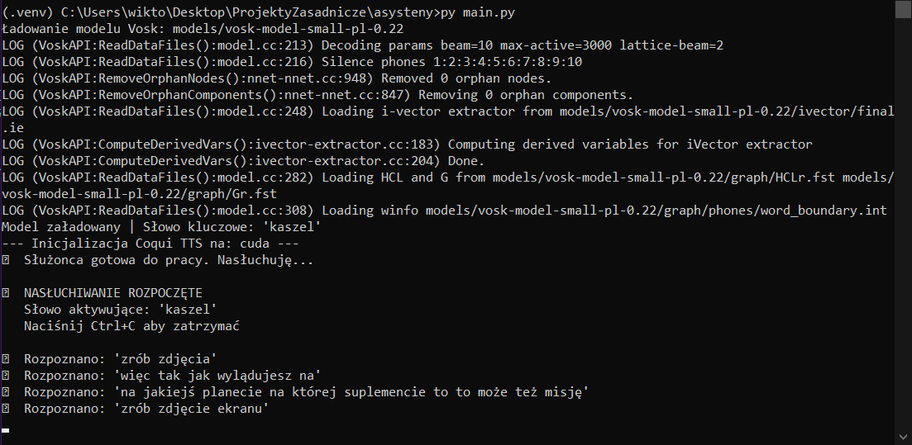
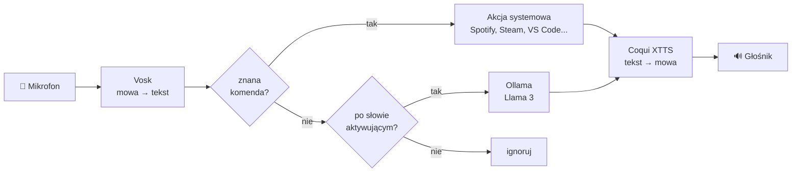

# CompAsist – asystent głosowy do obsługi komputera

Asystent sterowany głosem po polsku, działający **lokalnie**: rozpoznawanie mowy, model językowy i synteza mowy chodzą na Twoim komputerze, bez wysyłania nagrań do chmury.
Po słowie aktywującym wykonuje polecenia systemowe (Spotify, YouTube, Steam, VS Code, notatki, zrzuty ekranu). Gdy polecenie nie pasuje do żadnej komendy, przechodzi w tryb rozmowy z lokalnym LLM i odpowiada sklonowanym głosem.



## Technologie

| Obszar | Rozwiązanie |
|---|---|
| Rozpoznawanie mowy (STT) | [Vosk](https://alphacephei.com/vosk/), polski model offline, ciągłe nasłuchiwanie ze słowem aktywującym |
| Rozmowa | lokalny LLM przez [Ollama](https://ollama.com) (Llama 3), pamięć kontekstu rozmowy |
| Synteza mowy (TTS) | [Coqui XTTS v2](https://github.com/idiap/coqui-ai-TTS) z klonowaniem głosu z kilkusekundowej próbki, GPU (CUDA) |
| Integracje | Spotify Web API (`spotipy`), Steam, VS Code, Windows Audio (`pycaw`), `pyautogui` |
| Język | Python 3.10+ |

## Jak to działa



1. `core/stt.py` – ciągle słucha mikrofonu, wykrywa słowo aktywujące i wycina z wypowiedzi samo polecenie.
2. `utils/command_handler.py` – dopasowuje tekst do ponad 100 fraz z `data/commands.json` i wywołuje odpowiednią akcję.
3. `core/nlp.py` – gdy nie ma komendy, prowadzi rozmowę z lokalnym modelem, pamiętając ostatnie wiadomości.
4. `core/tts.py` – generuje odpowiedź głosem sklonowanym z próbki i od razu ją odtwarza.

## Co potrafi

| Kategoria | Przykładowe polecenia |
|---|---|
| Muzyka | „puść na spotify *Dawid Podsiadło*”, „zatrzymaj muzykę”, „głośniej” |
| Internet | „szukaj na youtube *…*”, „szukaj w google *…*”, „otwórz messenger” |
| Gry | „odpal grę *f1 24*”, „zamknij grę” (lista gier w `data/games.json`) |
| Programowanie | „otwórz projekt *…*” – fuzzy matching nazwy, a gdy projektu nie ma, pyta, czy go utworzyć i otwiera w VS Code |
| Zestawy aplikacji | „odpal zestaw *kodowanie*” – uruchamia kilka aplikacji naraz. Nieznany zestaw asystent tworzy w dialogu głosowym |
| Notatki | „zrób notatkę” (dyktowanie), „przeczytaj notatkę” |
| System | „zrób zdjęcie ekranu”, „która godzina”, „zmień głos *…*” |
| Rozmowa | wszystko inne po słowie aktywującym trafia do LLM |

## Instalacja (Windows)

```bash
git clone https://github.com/wikad/CompAsist.git
cd CompAsist
python -m venv .venv
.venv\Scripts\activate
pip install -r requirements.txt
```

1. **Model mowy:** pobierz [vosk-model-small-pl-0.22](https://alphacephei.com/vosk/models/vosk-model-small-pl-0.22.zip) i rozpakuj do `models/`.
2. **LLM:** zainstaluj [Ollamę](https://ollama.com), a potem:
   ```bash
   ollama pull llama3
   ollama create asystent -f models/asystent.Modelfile
   ```
3. **Głos:** wrzuć próbkę `.wav` (6–30 s) do `voices/` (szczegóły w [voices/README.md](voices/README.md)).
4. **Konfiguracja:** skopiuj `.env.example` jako `.env` i uzupełnij. Spotify jest opcjonalne: bez kluczy reszta komend działa normalnie.
5. Uruchom:
   ```bash
   python main.py
   ```
   albo `open.bat`, który uruchamia asystenta w tle, bez okna konsoli.

## Struktura

```
CompAsist/
├── main.py              # pętla główna: komenda albo rozmowa
├── config.py            # konfiguracja z .env
├── core/
│   ├── stt.py           # Vosk + słowo aktywujące
│   ├── nlp.py           # rozmowa z Ollamą
│   └── tts.py           # Coqui XTTS, klonowanie i zmiana głosu
├── utils/
│   ├── command_handler.py  # dopasowanie fraz → akcje
│   ├── audio_utils.py      # Spotify
│   ├── system_utils.py     # przeglądarka, notatki, screenshoty, głośność
│   ├── steam_controller.py # uruchamianie i zamykanie gier
│   ├── sets_utils.py       # zestawy aplikacji
│   └── vs_logic.py         # projekty w VS Code
├── data/                # komendy, gry, zestawy (JSON)
├── models/              # Modelfile dla Ollamy + model Vosk (lokalnie)
└── voices/              # próbki głosu (lokalnie)
```

## Plany

- detekcja słowa aktywującego dedykowanym modelem (np. openWakeWord) zamiast pełnego STT,
- rozpoznawanie intencji przez LLM zamiast dopasowania fraz,
- obsługa Linux/macOS.
